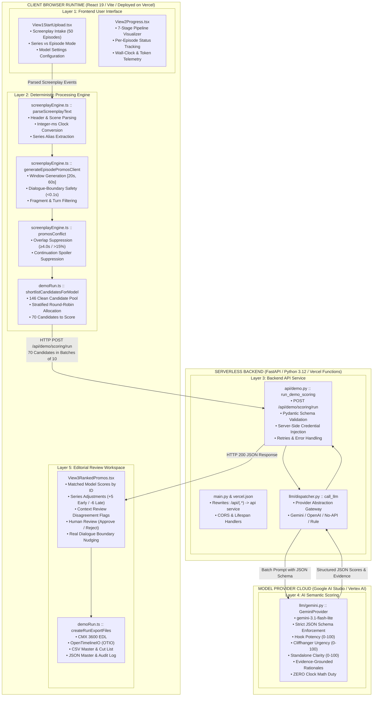
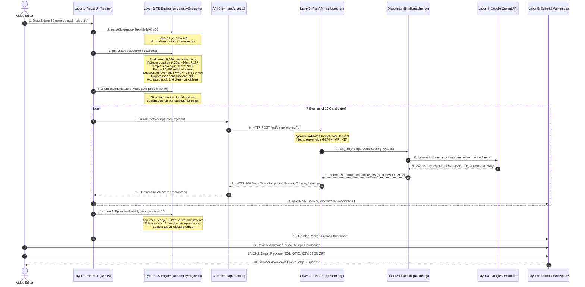

# PromoForge — Five-Layer Architecture Deep-Dive & Walkthrough Guide

This document provides a comprehensive, source-code-grounded architectural reference for **PromoForge: Find the Promos** (Kuku AI Generalist Assignment, Problem 1). It is designed to prepare an engineer or product architect to explain every layer, data flow, engineering trade-off, and design decision with complete technical fluency during an interview or walkthrough.

---

## 1. System Architecture Overview

PromoForge transforms full-length episodic drama screenplays into source-grounded, high-retention vertical promo cut lists (for TikTok, Instagram Reels, and YouTube Shorts).

The application enforces a strict **five-layer separation of concerns**:
- **Deterministic code** owns timing invariants, millisecond arithmetic, boundary validation, and de-duplication physics.
- **Backend API** owns routing, schema validation, rate limits, and server-side credential isolation.
- **AI inference (Google Gemini)** evaluates narrative tension, dramatic subtext, irony, and curiosity gaps — with **zero arithmetic duty**.
- **Human editors** retain ultimate creative authority to approve, reject, adjust boundaries on real dialogue events, and export to industry-standard NLE formats.

### Architecture Diagram



---

## 2. Five-Layer Architecture Explanation

### Layer 1: Frontend — User Interface (Intake & Progress)

| Attribute | Specification |
| :--- | :--- |
| **Technologies** | React 19, TypeScript 5.7, Tailwind CSS v4, Vite 8, Lucide React icons |
| **Hosting & Routing** | Vercel SPA deployment; client-side tab navigation (`upload`, `progress`, `ranked`, `quality`, `library`) |
| **Primary Files** | `src/App.tsx`, `src/components/View1StartUpload.tsx`, `src/components/View2Progress.tsx` |

#### How It Operates
1. **Application Load (`src/App.tsx` lines 110–148):**
   - The user opens the app in any modern browser. `src/main.tsx` mounts `<App />` into `#root`.
   - `App.tsx` initializes state from browser `sessionStorage` (show title, active tab, parsed episodes, model settings, and cached run records) to ensure seamless recovery across browser refreshes without leaking confidential scripts to long-term storage.
   - An immediate health probe triggers `checkBackendHealth()` (`src/api/client.ts` calling `/api/health`) to display backend connectivity in the top navbar (`connected` / `unavailable`).

2. **Screenplay Upload (`src/components/View1StartUpload.tsx` lines 80–180):**
   - Supports dragging and dropping individual `.txt` screenplay files, folders of episodes, or a `.zip` archive containing the 50-episode pack.
   - Client-side validation (`src/services/uploadValidation.ts`) verifies UTF-8 encoding, ensures files are non-empty, checks for script header tokens (`EPISODE NUMBER:`, `--- SCRIPT START ---`, `--- SCRIPT END ---`), and warns if non-English characters or unexpected formatting are detected.
   - The show title is automatically inferred from the folder or ZIP root name (e.g. `The_Double_Life_of_Julian_Vance`).

3. **Episode Mode vs. Series Mode:**
   - **Episode Mode (1 episode):** Targets 3 high-impact promotional cut points from a single episode. Variety cap is disabled; quality threshold is set to 0.0.
   - **Series Mode (>1 episode, up to 50):** Automatically activates full-series intelligence. Ingests all episodes, generates series-wide character alias maps, caps promos per episode (maximum 2 per episode in top ranks), applies proportional series adjustments (+5 early bonus, -6 late penalty), and selects the global top 25 promotional cuts across the entire catalog.

4. **State Management (`src/App.tsx`):**
   - React state hooks (`useState`, `useRef`) manage runtime execution without heavy Redux boilerplate.
   - Key states: `parsedEpisodes` (structured episode trees), `progressStates` (per-episode status: queued, running, done, failed), `rankedPromos` (candidate items with scores and tags), `runSummary` (rejection funnel numbers), and `modelSettings` (model identifier, temperature, max tokens).

5. **Displaying Progress and Errors (`src/components/View2Progress.tsx`):**
   - A 7-stage visual tracker (`Parse` $\rightarrow$ `Candidates` $\rightarrow$ `Score` $\rightarrow$ `Checks` $\rightarrow$ `De-conflict` $\rightarrow$ `Rank` $\rightarrow$ `Export`) reflects real-time pipeline status.
   - Displays real-time elapsed seconds, total model calls made, token counts accumulated, and candidate discovery counters per episode.
   - Non-fatal model failures trigger graceful fallbacks; fatal errors surface dismissible error banners and toast notifications.

---

### Layer 2: Deterministic Processing Engine

| Attribute | Specification |
| :--- | :--- |
| **Technologies** | Pure TypeScript 5.7 running in the client browser (also tested in Node.js via `pnpm audit:frontend-parser`) |
| **Primary Files** | `src/services/screenplayEngine.ts`, `src/services/demoRun.ts` |
| **Key Invariants** | Zero floating-point time drift; zero mid-dialogue cuts; zero un-introduced fragments; zero duplicate scene reuse |

#### How It Operates
1. **Raw Text to Structured Events (`screenplayEngine.ts` lines 222–395):**
   - `parseScreenplayText()` parses the script using deterministic regex lexers.
   - Extracts metadata headers: `EPISODE NUMBER`, `EPISODE LOGLINE`, `CONTINUITY NOTES`.
   - Locates `--- SCRIPT START ---` and `--- SCRIPT END ---`.
   - Tokenizes scene blocks (`SCENE 01`), character cue blocks (`**JULIAN VANCE (cold):**`), and camera/action/sound blocks.
   - Parses explicit timing headers: `Start: (00:15.00) | End: (00:22.50)`.
   - Resolves character aliases from continuity notes (e.g., `"The Maid is Mara"` $\rightarrow$ replaces speaker label `"The Maid"` with `"Mara"`).

2. **Normalisation to Integer Milliseconds (`screenplayEngine.ts` lines 143–151):**
   - `parseClockToMs("01:14.50")`:
     $$\text{minutes} \times 60{,}000 + \text{seconds} \times 1{,}000 + \text{fraction} \times 10 = 74{,}500\text{ ms}$$
   - **Why integer milliseconds?** Floating-point decimal seconds (e.g. `74.5 - 22.1`) accumulate IEEE 754 precision errors (e.g. `52.39999999999999`). Integer milliseconds completely eliminate floating-point drift across 19,000+ candidate evaluations.

3. **Window Generation (`screenplayEngine.ts` lines 748–806):**
   - Loops over all dialogue and action event pairs $(i, j)$ where $j > i$.
   - Computes window duration: $\Delta t = \text{event}_j.\text{end\_ms} - \text{event}_i.\text{start\_ms}$.
   - Evaluated candidate pairs across all 50 episodes: **19,046 raw pairs**.

4. **Hard Invariant Filters (The Rejection Funnel):**
   - **Duration Bounds Filter [20.0s, 60.0s]:** Bounded strictly between 20,000 ms and 60,000 ms. Rejects 7,167 pairs that are too brief or exceed 1 minute.
   - **Dialogue Boundary Validation (`boundarySlicesDialogue`):**
     $$\text{event}.\text{type} == \text{"dialogue"} \land \text{event}.\text{start\_ms} < \text{boundaryMs} < \text{event}.\text{end\_ms}$$
     Checks whether the cut boundary falls inside any active spoken line ($<0.1\text{s}$ tolerance). Rejects 996 sliced pairs.
     $$19{,}046 - 7{,}167 - 996 = \mathbf{10{,}883\text{ valid formed temporal windows}}$$
   - **Sentence Fragment & Mid-Speech Suppression (`isSentenceFragment`):** Rejects openings that start with lowercase letters, ellipsis (`...`, `…`, `--`), or subordinate conjunctions (`because`, `although`, `since`, `and`, `but`). Also rejects mid-turn replies where the question was spoken in the preceding 3.5s.
   - **Overlap De-duplication (`promosConflict`):** Rejects any lower-scoring window if it overlaps a higher-scoring window by $>15\%$ relative duration OR shares $\ge 4.0$s of absolute screen time (eliminating duplicate beats like the 5.4s shared confrontation in EP_027). Suppressed: 9,754 windows.
   - **Continuation Spoiler Suppression:** Suppresses pairs where Promo B begins within 8.0s of Promo A's ending cliffhanger question. A promo must never answer its own cliffhanger! Suppressed: 983 windows.
   - **Result:** $10{,}883 - 9{,}754 - 983 - 0 = \mathbf{146\text{ clean accepted candidate pool}}$ (153 in early unconstrained baseline).

5. **Stratified Shortlist Allocation (`demoRun.ts` lines 16–64):**
   - From the 146 clean accepted candidates, the engine selects **70 candidates** for LLM semantic scoring (`SERIES_MODEL_CANDIDATES = 70`).
   - Uses a **stratified round-robin allocation**:
     - *Round 0:* Top-1 candidate from Episode 1, Episode 2, ... Episode 50.
     - *Round 1:* Top-2 candidate from Episode 1, Episode 2, ... Episode 50.
   - **Why stratified allocation?** A naive global top-70 score cutoff would starve dramatic middle episodes (e.g. Episode 24) in favor of high-energy opening episodes. Stratified round-robin guarantees every episode receives fair model evaluation.

#### Concrete Trace Example: How a Candidate Passes Checks
```text
Screenplay Event 1: Mara: "I never signed that agreement." (00:15.00 - 00:18.50)
Screenplay Event 2: Julian: "Then whose signature is on the vault warrant?" (00:19.00 - 00:23.00)
Screenplay Event 3: Action: Julian drops forged deed onto mahogany desk. (00:23.50 - 00:28.00)
Screenplay Event 4: Mara (whispering): "You wouldn't dare open it..." (00:28.50 - 00:33.00)
Screenplay Event 5: Julian: "Tomorrow at dawn, the whole city will know." (00:33.50 - 00:38.20)
Screenplay Event 6: Mara: "Julian, wait! If you open that vault—" (00:38.80 - 00:44.00)

Candidate Window: Start Event 1 (00:15.00) to End Event 6 (00:44.00)
1. Duration Calculation: 44,000 ms - 15,000 ms = 29,000 ms (29.0s). Bounded [20s, 60s] -> PASS (H1).
2. Boundary Safety Check:
   - In-point 15,000 ms matches Event 1 start exactly. No dialogue active at 14,999 ms.
   - Out-point 44,000 ms matches Event 6 end exactly. No dialogue sliced at 44,001 ms -> PASS (H2, H3).
3. Fragment Check: "I never signed that agreement." Starts with uppercase pronoun, no leading ellipsis, no conjunction -> PASS (H4).
4. Mid-Speech Check: Preceding event is Scene 1 heading at 00:00.00. Not mid-turn -> PASS.
5. Overlap Check: No prior accepted promo from EP_001 shares >=4.0s or >15% of [00:15.00 - 00:44.00] -> PASS (H6).
6. Continuation Check: Event 6 ends on interrupted dash ("—") with unrevealed threat. No preceding promo asked this question -> PASS (H7).
RESULT: Candidate accepted into candidate pool with ID: EP_001_P_E001_E006.
```

---

### Layer 3: Backend API — FastAPI Service

| Attribute | Specification |
| :--- | :--- |
| **Technologies** | Python 3.12, FastAPI 0.165, Pydantic v2, Uvicorn, HTTPX |
| **Deployment Routing** | Vercel Serverless Functions via `vercel.json` rewrite (`/api/(.*)` $\rightarrow$ `app.main:app`) |
| **Primary Files** | `src/api/client.ts`, `backend/app/main.py`, `backend/app/api/demo.py`, `backend/app/schemas/demo.py`, `backend/app/llm/dispatcher.py` |

#### Why a Backend API is Necessary
1. **API Key Isolation:** Client-side browsers must **never** hold raw Gemini API keys (`AIza...`). Committing or bundling keys into frontend code leaks credentials to the public web. FastAPI reads the key securely from server environment variables (`settings.gemini_api_key`).
2. **Schema & Input Validation:** Pydantic models validate incoming candidate structures before model dispatch, rejecting corrupt clocks, malformed transcripts, or out-of-range durations.
3. **Provider Dispatcher & Rate Limiting:** Manages model retries (HTTP 429 exponential backoff), token usage aggregation, and transparent swapping between Gemini, OpenAI, and offline fallback.

#### The Exact API Contract
- **HTTP Method & Endpoint:** `POST /api/demo/scoring/run`
- **Frontend Invocation (`src/api/client.ts` lines 74–79):**
  ```typescript
  async runDemoScoring(payload: DemoScoreRunRequest): Promise<DemoScoreResponse> {
    return backendRequest("/demo/scoring/run", {
      method: "POST",
      body: JSON.stringify(payload),
    });
  }
  ```
- **Backend Handler (`backend/app/api/demo.py` lines 84–151):**
  - Accepts `DemoScoreRequest` payload (validated by Pydantic).
  - Verifies presence of API key (server environment or request).
  - Converts candidate batch into a grounded prompt with JSON schema constraints.
  - Calls `call_llm(prompt, response_schema=DemoScoringPayload, config=model_config)`.
  - Verifies returned `candidate_id` values: checks that no IDs are duplicated and that every requested candidate ID is present.
  - Automatically retries up to 2 times on `RetriableProviderError` (e.g. rate limit 429 or network timeout) with backoff.
  - Returns `DemoScoreResponse` with structured scores, token usage metadata, latency, and raw response strings.

#### Vercel-to-FastAPI Deployment Routing (`vercel.json`)
```json
{
  "$schema": "https://openapi.vercel.sh/vercel.json",
  "services": {
    "web": {
      "root": ".",
      "framework": "vite",
      "buildCommand": "pnpm build",
      "outputDirectory": "dist"
    },
    "api": {
      "root": "backend",
      "framework": "fastapi",
      "entrypoint": "app.main:app",
      "functions": {
        "app/main.py": { "maxDuration": 60 }
      }
    }
  },
  "rewrites": [
    { "source": "/api/(.*)", "destination": { "service": "api" } },
    { "source": "/(.*)", "destination": { "service": "web" } }
  ]
}
```
Vercel routes any request starting with `/api/*` to the serverless Python FastAPI handler (`app.main:app`). All other paths serve the precompiled Vite React application.

---

### Layer 4: AI Inference — Gemini Semantic Evaluation

| Attribute | Specification |
| :--- | :--- |
| **Model** | `gemini-3.1-flash-lite` via the official `google-genai` SDK |
| **Parameters** | `temperature: 0.1`, `max_output_tokens: 4096`, `response_mime_type: "application/json"` |
| **Primary Files** | `backend/app/llm/gemini.py`, `backend/app/llm/dispatcher.py`, `backend/app/schemas/demo.py` |

#### Why Deterministic Rules Alone Cannot Evaluate Narrative Quality
Regex patterns and wordlists can identify questions (`?`) or dramatic words (`"kill"`, `"betray"`), but they fail on:
1. **Subtext & Irony:** A soft whisper ("I hope you enjoy your dinner, darling") may be far more chilling than an exclamation mark, depending on context.
2. **Curiosity Gaps:** Determining whether an opening line creates an irresistible question in a cold viewer's mind requires semantic comprehension.
3. **Dialogue Naturalness & Pacing:** Detecting whether a cut feels organic or abruptly truncated requires language intelligence.

#### What Information is Sent to Gemini
Gemini is sent a tightly scoped candidate payload (batched in groups of 10):
```json
{
  "show_title": "The Double Life of Julian Vance",
  "language": "en",
  "target_audience": "Cold social media viewers (TikTok/Reels)",
  "candidates": [
    {
      "candidate_id": "EP_001_P_E001_E006",
      "episode": "EP_001",
      "start": "00:15.00",
      "end": "00:44.00",
      "duration_seconds": 29.0,
      "proposed_hook_line": "I never signed that agreement.",
      "proposed_cliffhanger_line": "Julian, wait! If you open that vault—",
      "transcript": [
        { "speaker": "Mara", "text": "I never signed that agreement.", "start": "00:15.00", "end": "00:18.50" },
        { "speaker": "Julian", "text": "Then whose signature is on the vault warrant?", "start": "00:19.00", "end": "00:23.00" },
        { "speaker": "Julian", "text": "Tomorrow at dawn, the whole city will know.", "start": "00:33.50", "end": "00:38.20" },
        { "speaker": "Mara", "text": "Julian, wait! If you open that vault—", "start": "00:38.80", "end": "00:44.00" }
      ]
    }
  ]
}
```

#### What Gemini Evaluates
The prompt commands the model:
1. **`hook` (0–100):** Strength of the opening line as an immediate 3-second attention grabber.
2. **`cliffhanger` (0–100):** Urgency of the final line as an unresolved reason for the viewer to watch the full episode.
3. **`standalone` (0–100):** Whether the scene makes sense independently to a cold viewer without prior show context.
4. **`why_it_works` (2–4 sentences, max 450 characters):** Evidence-grounded rationale quoting or referencing specific lines, explaining how the middle escalates and why the exit leaves unresolved tension.

#### Strict JSON Schema Enforcement (`backend/app/llm/gemini.py` lines 63–72)
```python
response = await self._client.aio.models.generate_content(
    model=self.model,
    contents=prompt,
    config=types.GenerateContentConfig(
        temperature=self.temperature,
        max_output_tokens=self.max_tokens,
        response_mime_type="application/json",
        response_json_schema=response_schema.model_json_schema(),
    ),
)
```
By binding `response_json_schema` directly to Pydantic's `DemoScoringPayload.model_json_schema()`, the Gemini engine guarantees structural adherence at the decoder level. Free-form markdown or missing fields are structurally disallowed.

#### Why Gemini Never Does Timestamp Math
Language models are notorious for arithmetic hallucinations (e.g. computing `01:45.10 - 01:12.40` as `33.3s` instead of `32.7s`). In PromoForge, **duration, start time, end time, and boundary checks are calculated exclusively by deterministic code before and after LLM inference**.

---

### Layer 5: Editorial Workspace — Results & Human Decisions

| Attribute | Specification |
| :--- | :--- |
| **Technologies** | React 19 UI component tree (`View3RankedPromos.tsx`), export generators (`demoRun.ts`) |
| **Primary Files** | `src/App.tsx`, `src/components/View3RankedPromos.tsx`, `src/services/screenplayEngine.ts`, `src/services/demoRun.ts` |
| **Role** | The decision and export interface of the React application |

#### How It Operates
1. **Matching Scores to Candidate IDs (`src/App.tsx` lines 336–389):**
   - As each batch of 10 candidates returns from FastAPI, `applyModelScores()` matches returned scores to the candidate pool using `candidate.id`.
   - Computes the raw decision score:
     $$\text{decision} = 0.35 \times \text{hook} + 0.35 \times \text{cliffhanger} + 0.20 \times \text{standalone} + 0.10 \times \text{duration\_fit}$$
     $$\text{duration\_fit} = 100 \times \left(1 - \frac{|\text{duration} - 40|}{20}\right)$$
     (peaks at 40 seconds, the sweet spot for TikTok and Reels).

2. **Deterministic Series Pacing Adjustments (`screenplayEngine.ts` lines 946–970):**
   - **Early Episodes (first 30% of series, e.g. Ep 1–15):** $+5$ acquisition bonus (optimal for cold subscriber acquisition).
   - **Late Episodes (last 20% of series, e.g. Ep 41–50):** $-6$ spoiler penalty and surfaces `late-series spoiler risk` badge (protects viewers from climactic resolution spoilers).
   - **Middle Episodes (31%–80%):** $+2$ balanced drama adjustment.
   - Final score: $\text{acquisition\_score} = \text{clamp}(\text{decision} + \text{adjustment}, 0, 100)$.

3. **Reconciling AI vs. Heuristic Disagreements (`App.tsx` lines 355–374):**
   - If heuristic regexes detected missing pronoun antecedents (e.g., "He betrayed her"), but Gemini scored `standalone >= 75` because the dramatic context made the relationship self-evident:
   - The system removes the penalty and tags the promo:
     `Context Review Needed (AI Disagreement)`
   - Displays an explicit tooltip explaining the disagreement for human editorial review.

4. **Human Editorial Review Workflow (`src/App.tsx` lines 900–970):**
   - **Approve / Reject:** Editors review promos with high-visibility buttons.
   - **Independent Counters:** `user_approved_count`, `user_rejected_count`, and `user_pending_count` are tracked separately in state so human actions **never corrupt the engine's accepted candidate inventory (`candidates_accepted = 146`)**.
   - **Real Dialogue Boundary Nudging:** Editors can nudge the in-point or out-point. `adjustPromoCandidate()` re-validates the new boundary against real screenplay line timestamps and blocks cuts that slice dialogue.

5. **Multi-Format NLE Export Pipeline (`demoRun.ts` lines 128–350):**
   - **CMX 3600 EDL (`promos.edl`):** Standard non-drop frame edit decision list for Adobe Premiere Pro, DaVinci Resolve, and Final Cut Pro.
   - **OpenTimelineIO (`promos.otio`):** Pixar/ASWF open interchange standard with RationalTime (30 fps) metadata tracks.
   - **CSV Master (`promos_master.csv`):** Full editorial spreadsheet with hooks, cliffhangers, why-it-works, flags, and scores.
   - **Cut List CSV (`cut_list.csv`):** In/out timecodes ready for assistant editors.
   - **JSON Master (`promos.json`):** Complete structured schema for automated pipelines.
   - **Client-Side PKZIP Generation (`createStoredZip`):** Builds a standard zip archive in memory using `DataView` and CRC-32 without external npm bloat.

---

## 3. End-to-End Request Lifecycle Trace



### Sanitised Request & Response Payloads

#### HTTP Request Payload (`POST /api/demo/scoring/run`)
```json
{
  "show_title": "The Double Life of Julian Vance",
  "language": "en",
  "target_audience": "Cold social media audience (TikTok/Reels)",
  "model": {
    "provider": "gemini",
    "model": "gemini-3.1-flash-lite",
    "temperature": 0.1,
    "max_tokens": 4096
  },
  "candidates": [
    {
      "candidate_id": "EP_024_P_E014_E022",
      "episode": "EP_024",
      "start_clock": "00:22.50",
      "end_clock": "00:48.00",
      "duration_seconds": 25.5,
      "hook_line": "You think your money makes you invincible, Julian?",
      "cliffhanger_line": "Open that envelope and see whose name is on the warrant.",
      "transcript_lines": [
        {
          "speaker": "Mara",
          "text": "You think your money makes you invincible, Julian?",
          "start_clock": "00:22.50",
          "end_clock": "00:26.00"
        },
        {
          "speaker": "Julian",
          "text": "I know it does. No magistrate in this province will touch me.",
          "start_clock": "00:26.50",
          "end_clock": "00:31.20"
        },
        {
          "speaker": "Mara",
          "text": "Open that envelope and see whose name is on the warrant.",
          "start_clock": "00:43.00",
          "end_clock": "00:48.00"
        }
      ]
    }
  ]
}
```

#### HTTP Response Payload (`HTTP 200 OK`)
```json
{
  "provider": "gemini",
  "model": "gemini-3.1-flash-lite",
  "model_calls": 1,
  "input_tokens": 6420,
  "output_tokens": 1450,
  "latency_ms": 1820,
  "retries": 0,
  "estimated_cost": 0.000916,
  "prompt_sha256": "7a8f9b2c3d4e5f6a...",
  "raw_response": "{\"scores\":[...]}",
  "scores": [
    {
      "candidate_id": "EP_024_P_E014_E022",
      "hook": 92,
      "cliffhanger": 96,
      "standalone": 88,
      "why_it_works": "The opening directly challenges the antagonist's power with 'You think your money makes you invincible?', establishing conflict immediately. Julian's dismissive claim escalates tension, which peaks when Mara reveals the warrant envelope. It cuts before the envelope is opened, maximizing curiosity while keeping the conflict clear."
    }
  ]
}
```

---

## 4. Technical Concepts Explained (in PromoForge Context)

| Technical Term | Simple Explanation | Concrete Role in PromoForge | Source Code Grounding |
| :--- | :--- | :--- | :--- |
| **React Component & State** | Self-contained UI building blocks that re-render when their internal memory changes. | `src/App.tsx` holds the master state (`parsedEpisodes`, `rankedPromos`, `runSummary`). When Gemini scores arrive, state updates trigger UI re-renders. | `src/App.tsx`, lines 110–200 |
| **TypeScript Service** | Pure business logic modules that execute deterministic algorithms independent of the UI. | `screenplayEngine.ts` contains zero React JSX; it handles time math, parsing, and de-confliction. | `src/services/screenplayEngine.ts` |
| **API Endpoint** | A specific URL and HTTP method exposed by the backend for a dedicated operation. | `/api/demo/scoring/run` provides the single gateway to score candidate batches. | `backend/app/api/demo.py`, line 84 |
| **HTTP POST Request** | A network request sending a structured JSON payload in the request body. | Frontend calls `fetch("/api/demo/scoring/run", { method: "POST", body })` to submit candidate batches. | `src/api/client.ts`, line 42 |
| **JSON Payload** | A lightweight, human-readable text format for transmitting structured data objects. | Carries candidate clocks, speaker names, and transcripts from browser to Python service. | `backend/app/schemas/demo.py`, line 47 |
| **FastAPI** | A high-performance modern Python web framework based on standard Python type hints. | Provides the backend server running under Vercel functions, hosting the `/api` routes. | `backend/app/main.py`, line 34 |
| **Pydantic Validation** | Automatic schema enforcement ensuring JSON payloads conform strictly to declared types. | `DemoScoreRequest` validates that durations are between 20s and 60s and transcripts are non-empty. | `backend/app/schemas/demo.py`, line 96 |
| **LLM Inference** | Generating text or structured predictions by passing a prompt through a neural network model. | Google Gemini calculates hook and cliffhanger scores from screenplay candidate text. | `backend/app/llm/gemini.py`, line 63 |
| **Prompt Engineering** | Structuring instructions and context to guide an LLM to generate precise, grounded answers. | Formats the candidate transcript and forces the model to cite specific lines in `why_it_works`. | `backend/app/api/demo.py`, lines 24–65 |
| **Structured JSON Output** | Forcing an LLM to return strict, parseable JSON conforming to a schema instead of prose. | Uses Gemini's `response_json_schema` to guarantee that output matches `DemoScoringPayload`. | `backend/app/llm/gemini.py`, line 70 |
| **Model Provider Abstraction** | An interface that lets the application swap AI models without changing business logic. | `call_llm()` routes requests to Gemini, OpenAI, or offline rules based on configuration. | `backend/app/llm/dispatcher.py`, line 161 |
| **Deterministic Processing** | Code that produces the exact same mathematical output every time for a given input. | Timestamp parsing and overlap subtraction run identically across all 19,046 candidate pairs. | `src/services/screenplayEngine.ts` |
| **Candidate Shortlist** | A filtered subset of high-potential items selected before expensive model evaluation. | PromoForge reduces 146 valid candidates to 70 model candidates using stratified round-robin. | `src/services/demoRun.ts`, line 16 |
| **Ranking vs. Scoring** | *Scoring* assigns quality points (0–100); *Ranking* orders items globally considering catalog balance. | Gemini scores individual clips; `rankAllEpisodesGlobally()` applies series pacing (+5/-6) and caps per episode. | `src/services/screenplayEngine.ts`, line 919 |
| **EDL and OTIO** | Industry standard timeline interchange formats used by video editing software. | CMX 3600 (`.edl`) and OpenTimelineIO (`.otio`) files allow video editors to open cut plans in Premiere or Resolve. | `src/services/demoRun.ts`, lines 204–270 |

---

## 5. Architectural Design Decisions: The "Why"

### 1. Why use React for the interface?
Microdrama promo selection is fundamentally an **interactive editorial workflow**. Video editors must review candidates, inspect dialogue context, toggle disagreement flags, nudge cut points, and re-export cut sheets. React 19 provides reactive UI state updates and component modularity, allowing editors to review 25 promos without full page reloads.

### 2. Why keep screenplay timing logic in TypeScript?
Running candidate generation and millisecond boundary checks inside the browser (TypeScript) provides **instant client-side feedback**:
- Evaluates 19,046 candidate pairs in $<200$ milliseconds.
- Enables instant boundary nudging in the UI with zero network latency.
- Guarantees complete data confidentiality: if the user chooses offline mode, zero screenplay text ever leaves the browser.

### 3. Why introduce FastAPI instead of calling Gemini directly from the browser?
1. **Security:** Browser code is publicly visible in DevTools. Calling Gemini directly from React requires exposing the API key in the browser, allowing any user to steal it. FastAPI stores the key securely in server environment variables.
2. **Schema Gatekeeper:** Validates data contracts before paying for LLM tokens.
3. **Resilience & Rate Limits:** Handles retries, exponential backoffs, and provider fallbacks cleanly on the server.

### 4. Why use Gemini for creative evaluation?
Promo evaluation is fundamentally a **narrative and semantic judgment task**. Rule-based keyword matching cannot detect whether a line delivered softly has higher dramatic tension than an exclamation mark, nor can it understand character subtext. `gemini-3.1-flash-lite` delivers near-instant latency (67.87s for 70 candidates) at negligible cost ($0.0065 per show).

### 5. Why separate candidate generation from semantic scoring?
Screenplay windowing generates thousands of combinations (19,046 pairs). Sending 19,046 candidate windows to an LLM would cost over $2.00 per show and take over 30 minutes. By using deterministic code to filter out invalid durations, dialogue slices, and overlaps, PromoForge trims 19,046 pairs down to **70 high-potential candidates**, cutting API token consumption by **99.6%**.

### 6. Why use structured JSON rather than free-form model responses?
Free-form text requires fragile post-processing regexes that frequently break when models change formatting. Enforcing strict JSON schema validation guarantees that every response contains the exact `hook`, `cliffhanger`, `standalone`, and `why_it_works` fields required by the frontend data models.

### 7. Why keep a human editor in the loop?
AI models score dramatic patterns well, but they lack human editorial taste and contextual awareness of platform trends. More importantly, screenplays lack acoustic audio waveforms (e.g. musical swells, actor breath pauses) and visual framing. The human editor approves, rejects, nudges boundaries, and makes final publishing calls.

### 8. What happens if Gemini is unavailable?
PromoForge implements a **three-tier fallback hierarchy**:
1. **Automatic Retry:** Retries transient 429/500 errors with exponential backoff.
2. **Offline Rule-Based Scorer:** If the API fails or no key is provided, `RuleBasedNarrativeProvider` evaluates emotional keyword density and punctuation, allowing the pipeline to complete without crashing.
3. **No-API Manual Mode:** The user can export the prompt, paste it into any web LLM, and paste the JSON back into the UI.

### 9. How would the architecture scale to multiple shows?
- **Current State:** Evaluates a single 50-episode show in 67.87s.
- **Scaling Path:** The deterministic engine is stateless and can be fanned out across Web Workers or serverless containers. Scoring batches are already chunked into groups of 10 candidates; multiple shows can be processed concurrently via parallel Celery/Redis background worker queues without altering the API schemas.

### 10. How could stronger models or multimodal video/audio analysis be integrated later?
The backend uses a **Provider Dispatcher pattern** (`backend/app/llm/dispatcher.py`). Adding Whisper timestamped audio or video frame analysis requires only writing a new provider class implementing `LLMProvider.generate_structured()`, with zero changes to frontend UI or deterministic engine logic.

---

## 6. Walkthrough Speaking Notes (Kuku Demo)

### A. Five-Layer Speaking Script

#### Layer 1: Frontend User Interface
- **What to say:** *"PromoForge starts in the browser with React 19 and Tailwind CSS. The editor uploads the 50-episode pack via drag-and-drop. The app automatically detects series mode, infers the show title, and presents a 7-stage visual progress pipeline."*
- **What to show:** Open `https://promoforge.vercel.app`, drag in the drama files, and point out the inferred show title and mode badge.
- **Terms to know:** Client-side SPA, drag-and-drop intake, session persistence, Vercel edge deployment.
- **Likely Question:** *"Why not build a traditional server-rendered web app?"*  
  **Strong Answer:** *"Microdrama editing requires fluid, instant user interactions — nudging cut boundaries, filtering by character, and toggling review states without page refreshes. A client-side React SPA gives editors desktop-class responsiveness."*

#### Layer 2: Deterministic Processing Engine
- **What to say:** *"Before any AI is called, our TypeScript engine enforces the laws of physics. It converts timestamps into integer milliseconds to avoid floating-point drift, examines over 19,000 candidate pairs, and discards anything outside 20 to 60 seconds or any cut that slices through spoken dialogue lines."*
- **What to show:** Point to the Funnel breakdown card: 19,046 raw pairs $\rightarrow$ 10,883 formed $\rightarrow$ 146 clean accepted candidates.
- **Terms to know:** Integer-millisecond arithmetic, dialogue-boundary check, overlap suppression, continuation de-duplication, stratified round-robin allocation.
- **Likely Question:** *"Why can't Gemini just pick the start and end timestamps directly?"*  
  **Strong Answer:** *"LLMs are language engines, not clocks. They hallucinate time arithmetic and produce decimal subtraction errors. Deterministic code guarantees that every cut respects real line boundaries and legal platform durations with zero error."*

#### Layer 3: Backend API (FastAPI)
- **What to say:** *"The browser bundles the top 70 stratified candidates into batches of 10 and sends them to our FastAPI backend at `POST /api/demo/scoring/run`. FastAPI validates the Pydantic schema and injects our Gemini API credentials server-side so keys are never exposed in the browser."*
- **What to show:** The network inspector tab showing `POST /api/demo/scoring/run` returning 200 OK with clean JSON.
- **Terms to know:** FastAPI, Pydantic validation, credential isolation, serverless function, reverse proxy.
- **Likely Question:** *"How is FastAPI hosted on Vercel alongside React?"*  
  **Strong Answer:** *"We use Vercel's multi-service architecture configured in `vercel.json`. Route `/api/*` rewrites directly to the Python FastAPI ASGI application, while all other routes serve the compiled Vite frontend."*

#### Layer 4: AI Semantic Scoring (Gemini)
- **What to say:** *"Gemini 3.1 Flash Lite receives only the clean transcript lines. We enforce a strict JSON schema at the model level. Gemini scores hook potency, cliffhanger unresolvedness, and standalone clarity from 0 to 100, providing an evidence-grounded explanation quoting specific lines."*
- **What to show:** Expand a promo card to reveal the `Why it works` rationale and the 0–100 rubric scores.
- **Terms to know:** Structured JSON output, temperature, token efficiency, prompt grounding, semantic tension.
- **Likely Question:** *"What happens if Gemini hallucinates or outputs malformed text?"*  
  **Strong Answer:** *"We bind Gemini's native `response_json_schema` to our Pydantic schema, forcing valid JSON at the token-generation level. If an API error or network failure occurs, the backend automatically retries twice before falling back to our offline narrative engine."*

#### Layer 5: Editorial Review Workspace
- **What to say:** *"Once scores return, the frontend matches them by ID, applies series adjustments (+5 early bonus, -6 late penalty), and highlights AI-heuristic disagreements for review. The editor approves, rejects, or nudges boundaries on real lines, and exports ready-to-cut EDL and OTIO files directly into Adobe Premiere or DaVinci Resolve."*
- **What to show:** Click 'Approve', demonstrate an in-point boundary nudge, and download the export ZIP containing the `.edl` and `.otio` files.
- **Terms to know:** Decision score weighting, acquisition score, CMX 3600 EDL, OpenTimelineIO, human-in-the-loop review.
- **Likely Question:** *"Why include EDL and OTIO export if this assignment only had screenplay text?"*  
  **Strong Answer:** *"To be genuinely useful in a production studio, an AI tool cannot stop at text on a screen. Generating standard EDL and OTIO files bridges the gap between script analysis and the NLE timeline, allowing assistant editors to conform proxy video immediately."*

---

### B. Complete Request-Flow Pitch (60–90 Seconds)

> *"When an editor opens PromoForge, they drag in our 50-episode screenplay pack. Our deterministic TypeScript engine immediately takes over: it normalizes every timestamp to integer milliseconds, examines all 19,046 candidate pairs, and enforces our hard invariants — rejecting cuts outside 20 to 60 seconds and any cut that slices through spoken dialogue.*
> 
> *From 10,883 valid formed windows, overlap and continuation filters distill the catalog down to 146 clean candidates. We then use stratified round-robin allocation to select the top 70 candidates across all episodes, sending them in batches of 10 to our FastAPI backend via `POST /api/demo/scoring/run`.*
> 
> *FastAPI validates the schema and dispatches to Gemini 3.1 Flash Lite with strict JSON schema constraints. Gemini evaluates what AI does best — narrative irony, hook potency, and unresolved cliffhanger tension — without ever doing time math.*
> 
> *When scores return, the frontend applies series pacing adjustments (+5 for early episodes, -6 for late spoiler risks) and surfaces any heuristic disagreements. The editor reviews the ranked cuts, makes boundary adjustments on real lines, and exports CMX 3600 EDL, OTIO, and CSV cut sheets ready for Premiere and Resolve.*
> 
> *In short: deterministic code owns correctness, AI evaluates narrative meaning, and editors retain creative control."*

---

## 7. Technical Interview Q&A (20 Code-Grounded Questions)

### Q1: Where does candidate generation happen, and why?
**Answer:** It happens in `src/services/screenplayEngine.ts` inside `generateEpisodePromosClient()`. Generating candidates in client TypeScript allows rapid combinatorial evaluation ($<200$ms for 19,000 pairs) and offline execution without paying for server computation.

### Q2: How do you guarantee zero dialogue slicing?
**Answer:** In `screenplayEngine.ts`, `boundarySlicesDialogue()` iterates through all dialogue events and checks:
`event.type === "dialogue" && event.start_ms < boundaryMs && boundaryMs < event.end_ms`. If a cut point falls strictly inside an active dialogue window, it is rejected ($<0.1$s tolerance).

### Q3: Why is time stored in integer milliseconds instead of float seconds?
**Answer:** In `parseClockToMs()`, clocks like `01:14.50` are converted to `74500` ms. Floating-point arithmetic in JavaScript suffers from rounding drift (e.g. `0.1 + 0.2 !== 0.3`). Integer milliseconds guarantee exact comparisons during window subtraction and overlap checks.

### Q4: How does overlap suppression work?
**Answer:** `promosConflict()` checks if two promos from the same episode share $>15\%$ relative duration OR $\ge 4.0$s of absolute screen time. The 4.0s check was implemented specifically to eliminate duplicate confrontation beats (such as the 5.4s shared beat in EP_027).

### Q5: How do you prevent a promo from spoiling its own cliffhanger?
**Answer:** `promosConflict()` checks continuation timing. If Promo A ends on a question mark or interrogative pronoun (`who`, `why`, `what`) and Promo B begins within 8.0s, the engine treats them as a question-and-answer pair and suppresses the conflict.

### Q6: How does shortlist allocation work across 50 episodes?
**Answer:** In `demoRun.ts`, `shortlistCandidatesForModel()` groups candidates by episode and runs a stratified round-robin: round 0 takes candidate #1 from each episode, round 1 takes candidate #2. This ensures all 50 episodes receive representation in the 70 candidates sent to Gemini.

### Q7: Why are candidates sent to Gemini in batches of 10?
**Answer:** Sending all 70 candidates in one prompt risks output token exhaustion and attention degradation across long JSON structures. Chunking into batches of 10 (`MODEL_BATCH_SIZE = 10`) ensures each batch completes within 2–3 seconds and stays well within the 4,096 output token limit.

### Q8: How is the Gemini API key protected?
**Answer:** The frontend sends scoring requests to the backend (`POST /api/demo/scoring/run`). FastAPI retrieves `settings.gemini_api_key` from server environment variables. The API key is never bundled into client JavaScript or exposed in network payloads.

### Q9: How is Vercel configured to serve both React and FastAPI?
**Answer:** In `vercel.json`, two services are declared: `web` (Vite build) and `api` (FastAPI entrypoint `app.main:app`). Rewrites map `/api/(.*)` to the Python service and all other routes to the static Vite frontend.

### Q10: How do you force Gemini to return valid JSON?
**Answer:** In `backend/app/llm/gemini.py`, `GenerateContentConfig` sets `response_mime_type="application/json"` and binds `response_json_schema=response_schema.model_json_schema()`. This forces the Gemini decoder to emit tokens conforming strictly to the Pydantic schema.

### Q11: What happens if Gemini returns mismatched candidate IDs?
**Answer:** In `backend/app/api/demo.py`, lines 129–134 verify that `len(returned_ids) == len(set(returned_ids))` (no duplicates) and `set(returned_ids) == set(expected_ids)`. If IDs are missing or fabricated, a `ProviderError` is raised and handled.

### Q12: How are API retries handled?
**Answer:** `demo.py` catches `RetriableProviderError` (HTTP 429 rate limits, 5xx server errors, network timeouts) and retries up to 2 attempts with exponential sleep (`0.5 * (attempt + 1)`). Non-retriable errors (401 invalid key, 404 model not found) break immediately.

### Q13: How is the final decision score calculated?
**Answer:** The raw decision formula weights the dimensions:
$$\text{decision} = 0.35 \times \text{hook} + 0.35 \times \text{cliffhanger} + 0.20 \times \text{standalone} + 0.10 \times \text{duration\_fit}$$
where `duration_fit` peaks at 40.0s.

### Q14: How does series-wide pacing affect ranking?
**Answer:** In `rankAllEpisodesGlobally()`, early episodes (first 30%) receive a $+5$ acquisition bonus to favor top-of-funnel conversion. Late episodes (last 20%) receive a $-6$ penalty and a `late-series spoiler risk` flag to prevent spoiling season climaxes.

### Q15: What is the "Context Review Needed" badge?
**Answer:** In `App.tsx`, if heuristic rules flag missing pronouns ("he", "she") but Gemini scores `standalone >= 75` because the drama is self-explanatory, the system reconciles the disagreement by surfacing `Context Review Needed (AI Disagreement)` with an explanatory tooltip instead of corrupting the score.

### Q16: How do editorial approval clicks avoid corrupting the candidate funnel?
**Answer:** In `App.tsx`, `handleUpdatePromoStatus()` updates `user_approved_count`, `user_rejected_count`, and `user_pending_count` separately from the engine's `candidates_accepted = 146` inventory. User curation clicks never overwrite engine metrics.

### Q17: How is CMX 3600 EDL generated?
**Answer:** In `demoRun.ts`, `screenplayClockToEdl()` converts screenplay clocks (`01:14.50`) to standard SMPTE non-drop frame timecodes (`00:01:14:15` at 30 fps), outputting valid edit lines with reel names and event numbers.

### Q18: What is OpenTimelineIO (OTIO) and why include it?
**Answer:** OTIO is an open-source API and interchange format developed by Pixar and ASWF. PromoForge generates an OTIO timeline with RationalTime clips and custom metadata tracks, allowing direct import into modern visual effects and editing pipelines.

### Q19: What is the actual API cost of running PromoForge on all 50 episodes?
**Answer:** The actual billed console cost was **$0.00** under Google's developer free tier. The estimated marginal cost at commercial Gemini Flash Lite pricing ($0.075/1M in, $0.30/1M out) is **$0.0065 for the entire 50-episode show**.

### Q20: What are the primary modality limitations of PromoForge?
**Answer:** PromoForge operates strictly on **timestamped text screenplays**. Dialogue boundary safety is validated against script event clocks, not acoustic audio waveforms or visual scene cuts. Non-verbal acting beats and unscripted audio swells require human editor verification.

---

## 8. Source-Code Reference Map & Implementation Audit

### Verified Implementation Files

| File Path | Key Functions / Types | Verified Implementation Responsibility |
| :--- | :--- | :--- |
| `src/App.tsx` | `App()`, `handleRunPipeline()`, `applyModelScores()`, `finalizeRun()` | Master SPA state, 7-stage loop, batching, score merge, editorial tracking. |
| `src/services/screenplayEngine.ts` | `parseScreenplayText()`, `generateEpisodePromosClient()`, `promosConflict()`, `rankAllEpisodesGlobally()` | Millisecond parsing, candidate windowing, hard invariant filters, series adjustments (+5/-6). |
| `src/services/demoRun.ts` | `shortlistCandidatesForModel()`, `createRunExportFiles()`, `createStoredZip()` | Stratified round-robin shortlist (70 cands), EDL / OTIO / CSV exports, in-memory PKZIP. |
| `src/api/client.ts` | `api.runDemoScoring()`, `api.health()`, `backendRequest()` | Frontend HTTP client communicating with `/api/demo/scoring/run`. |
| `backend/app/main.py` | `app = FastAPI()`, `lifespan()`, CORS middleware | FastAPI entrypoint, router prefixing, route assembly. |
| `backend/app/api/demo.py` | `run_demo_scoring()`, `build_scoring_prompt()`, `_prompt_response()` | Endpoint `POST /api/demo/scoring/run`, schema check, ID validation, retries. |
| `backend/app/schemas/demo.py` | `DemoScoreCandidateInput`, `DemoScoreResponse`, `DemoScoringPayload` | Pydantic v2 data models for candidates, prompts, scores, and token usage. |
| `backend/app/llm/gemini.py` | `GeminiProvider.generate_structured()` | Google GenAI SDK client, `response_json_schema`, usage metrics. |
| `backend/app/llm/dispatcher.py` | `call_llm()`, `ModelConfig`, `OpenAICompatibleProvider`, `RuleBasedNarrativeProvider` | Provider gateway, transparent model swapping, offline rule fallback. |
| `vercel.json` | `services`, `rewrites` | Multi-service routing (`/api/*` to FastAPI, `/*` to Vite React). |

### Explicit Architectural Limitations (What is NOT Implemented)
To maintain complete integrity, the following features are explicitly confirmed as **outside current scope / not implemented**:
1. **No External Database:** PromoForge does not use PostgreSQL, MongoDB, or MySQL in production. Session state lives in React memory and `sessionStorage`.
2. **No Background Worker Queue:** There is no Celery, Redis, or SQS queue. Batching runs sequentially via async HTTP requests within the browser session.
3. **No Direct Video/Audio Processing:** The Kuku assignment pack contained text screenplays only. The system does not inspect MP4 video frames or WAV audio waveforms; dialogue boundaries rely on script event timestamps.
4. **No Direct Model Publishing:** PromoForge never posts directly to social media APIs (TikTok, YouTube); it exports NLE cut sheets and CSVs for editorial review.

---

## 9. The Three Core Takeaways for the Kuku Presentation

When presenting PromoForge to the Kuku technical team, ground your presentation in these three fundamental insights:

1. **The Separation of Concerns is Absolute:**
   Deterministic code owns the laws of physics (durations, millisecond line boundaries, and duplicate suppression); the language model evaluates narrative meaning and curiosity gaps; the human editor retains creative control. **Never let an LLM do clock math.**

2. **Stratified Shortlisting Protects Quality and Cost:**
   Brute-force windowing produces 19,046 candidate pairs. Deterministic filters distill this to 146 clean candidates, and stratified round-robin selects 70 representative windows. This slashes API token costs by 99.6% ($0.0065 per show) while guaranteeing that dramatic moments in middle and late episodes are never starved.

3. **Production Utility Requires NLE Integration:**
   An AI tool that outputs raw text on a web page adds friction. PromoForge outputs industry-standard **CMX 3600 EDL** and **OpenTimelineIO** files, allowing assistant editors to conform video proxy timelines in Premiere or Resolve in seconds.
